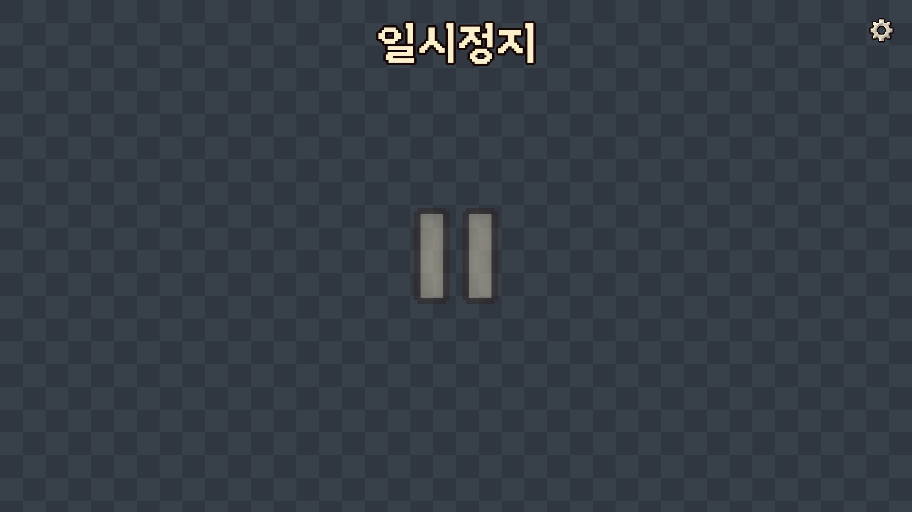

[← 포트폴리오](../README.md)

# 일시정지! · GamePaused

**시간을 멈추고 점프를 설계하며 성벽을 오르는 2D 도트 등반 플랫포머입니다.**

정지 중 점프를 예약하고 재생 후 결과를 확인하는 구조를 기획했습니다. 성벽 정상에서 조력자 ESC의 배신으로 정지 기능을 잃으면 익숙한 규칙을 다른 조건에서 사용하게 됩니다.

| 항목 | 내용 |
| --- | --- |
| 제작 형태 | 2인 팀 프로젝트 |
| 본인 역할 | **메인 기획** |
| 담당·참여 범위 | 게임 아이디어·콘셉트·게임성·핵심 규칙·스토리·UI·콘셉트 디자인 등 기획과 디자인 전반 |
| 제작 방식 | 기획 구체화와 디자인·콘텐츠 및 개발 전반에 AI 활용 |
| 목표 플랫폼 | PC · 기획 기준 |
| 현재 상태 | 미완성 프로토타입 · 최종 플레이 화면과 시연 자료 준비 중 |

본인의 기여는 프로그래밍을 제외한 기획·디자인을 중심으로 설명합니다. 팀의 프로토타입 구현과 본인이 직접 담당한 기획 범위를 구분합니다.

## 핵심 규칙과 설계 의도

| 규칙 | 플레이어의 판단 | 기획 의도 |
| --- | --- | --- |
| 방향키 없이 점프와 벽 충돌로 이동·방향 전환 | 어떤 벽과 발판을 경유할지 선택 | 적은 조작으로 경로를 읽는 재미 구성 |
| ESC로 시간을 멈추고 Space를 누른 시간으로 점프 강도 예약 | 관찰한 지형에 맞춰 강도와 순서 결정 | 관찰 → 계획 → 실행 → 결과 확인의 흐름 |
| 초반 예상 궤도 가이드와 높이에 따른 축소 | 안내를 참고하다 점차 거리 감각으로 판단 | 학습에서 숙련으로 이어지는 과정 |
| 정상의 사건 이후 정지 기능 상실 | 익힌 차지·벽 반사 규칙을 다른 조건에서 활용 | 스토리를 실제 플레이 변화로 연결 |
| 업적에 따른 추가 스테이지·코스튬 해금 | 다른 방식의 클리어와 기록 갱신 시도 | 최종 클리어 이후의 목표 제공 |

표의 경험은 설계 목표입니다. 전체 게임의 완성이나 플레이 테스트로 효과가 검증된 결과를 뜻하지 않습니다.

## 한 번의 플레이 흐름 · 기획 기준

1. 지형과 벽의 위치 및 캐릭터 방향을 확인합니다.
2. ESC로 정지하고 Space 입력 시간으로 점프를 예약합니다.
3. 정지를 해제해 실행한 뒤 착지·추락 결과를 확인합니다.
4. 다음 발판과 벽을 보고 새로운 점프를 계획합니다.

정지 상태에서도 타이머가 흐르는 3초 파괴 발판을 기획해 무제한 계획에 제약을 둡니다. 연속 점프의 세부 실행 규칙과 구름 발판의 소멸 조건은 후속 조정 대상입니다.

## 스토리와 시스템 변화 · 기획 기준

| 구간 | 사건 | 플레이 변화 |
| --- | --- | --- |
| 전반부 | 정지 기능을 활용해 성벽 등반 | 예약과 궤도 판단 학습 |
| 정상 | '일시정지' 글자 파괴와 ESC의 배신 | 저장 후 강제 종료 연출 |
| 재실행 | 변형된 성벽 재등반 | ESC를 사용할 수 없는 조건 |
| 결말 | ESC 보스전과 어퍼컷 및 크레딧 | 도트 현실 장면으로 전환 |

마지막에는 부서진 모니터와 키보드를 보며 “…모니터랑 키보드 다시사야지”라고 말하는 결말을 기획했습니다. 최종 클리어 후 새 메인 게임에서는 ESC 기능을 복구하고 업적·해금은 유지하는 방향입니다.

배신 이후 직접 차지 점프와 보스전의 상세 조작·패턴은 아직 확정·검증해야 할 항목입니다.

## UI·콘셉트 디자인 시안

**아래 이미지는 AI를 활용해 제작한 UI 디자인 시안입니다. 실제 게임 실행 화면이나 최종 적용 완료 화면이 아닙니다.**

### 메인 메뉴의 디자인 방향

게임 시작·설정·종료를 중심으로 메뉴를 배치하고 도트 캐릭터와 컴퓨터를 통해 게임의 현실 장면과 연결하는 시각 방향을 구성했습니다.

### 일시정지 오버레이 시안

정지 상태를 알리는 제목과 아이콘 및 설정 진입 위치를 표현한 구성 예시입니다. 게임 배경 위에서의 가독성과 실제 입력 동선은 적용 후 확인할 항목입니다.

## 제작 범위와 다음 확인

| 구분 | 현재 내용 |
| --- | --- |
| 기획 자료 | 2026-10-28 통합 기획서 v1.0 · 16쪽을 바탕으로 규칙·스토리·화면 방향 정리 |
| 프로토타입 코드 | 점프 입력 기록·이동 시뮬레이션·벽 반사·예상 궤도·발판·기믹·카메라·HUD 포함 |
| 후속 설계 | 후반부 조작과 보스전 상세 규칙. 업적 최종 수치. 연속 점프 세부 규칙 |
| 후속 검증 | 전체 스토리 연결과 완주. UI 적용. 난이도와 가이드 축소 구간 |
| 시연 자료 | 최종 플레이 화면·영상 준비 중 |

원본 개발 저장소는 비공개로 유지합니다. 이 페이지는 기획 의도와 담당 범위 및 시안을 공개한 소개 자료입니다.

[← 대표 프로젝트 목록](../README.md)
